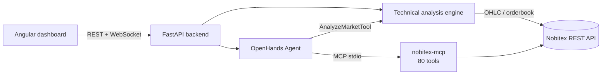

# Nobi — Nobitex Trading Agent

An AI trading assistant for the [Nobitex](https://nobitex.ir) exchange. It runs technical
analysis on crypto markets, ranks opportunities, and can place orders on your behalf through
the [Nobitex MCP server](https://github.com/arashjfz/nobitex-mcp) — all driven by the
[OpenHands Software Agent SDK](https://docs.openhands.dev/sdk).

- **Backend** — Python / FastAPI, OpenHands Agent SDK, vendored `nobitex-mcp` (80 tools).
- **Frontend** — Angular 20 single-page dashboard (chat, chart, signals, order ticket).
- **Safety first** — paper trading and a withdrawal-free toolset are the defaults.

> Crypto trading is risky. This is not financial advice. You are responsible for every order.

---

## How it works



The agent is created with the Nobitex MCP server **already configured as a default tool
source**, plus a custom `AnalyzeMarketTool` that exposes the local indicator engine. You can
chat with it ("find the best opportunity", "buy 0.001 BTC if the 1h signal is BUY") and it
will call the MCP tools to read markets, inspect balances, and place orders.

### Technical analysis

`backend/app/technical.py` fetches OHLC candles from Nobitex and computes:

| Indicator | Used for |
| --- | --- |
| EMA 20 / EMA 50 | trend direction and crossovers |
| RSI 14 | overbought / oversold |
| MACD (12/26/9) | momentum and histogram flips |
| Bollinger Bands (20, 2σ) | volatility and %B position |
| ATR 14 | stop-loss sizing |
| Stochastic %K | short-term reversals |
| Volume vs SMA20 | signal confirmation |

Each factor votes with a weight; the result is a `BUY` / `SELL` / `HOLD` call with a
confidence score, support/resistance levels, and an ATR-based entry / stop / target plan.

---

## Quick start

### 1. Backend

```bash
cp .env.example .env          # add LLM_API_KEY and Nobitex credentials
cd backend
python -m venv .venv && source .venv/bin/activate
pip install -e ".[dev]"       # or: uv sync --extra dev
uvicorn app.main:app --reload --port 8011
```

The API is now at `http://127.0.0.1:8011` (docs at `/docs`).

### 2. Frontend

```bash
cd frontend
npm install
npm start                     # ng serve with proxy.conf.json -> port 8011
```

Open `http://localhost:4200`.

> The dev proxy targets port **8011** because port 8000 is commonly taken by other local
> services. Change `frontend/proxy.conf.json` if you run the backend elsewhere.

---

## Configuration

All settings are read from `.env` (repo root or `backend/.env`).

| Variable | Default | Purpose |
| --- | --- | --- |
| `LLM_MODEL` | `anthropic/claude-sonnet-4-5-20250929` | LiteLLM model name |
| `LLM_API_KEY` | — | Provider key (required for chat) |
| `LLM_BASE_URL` | — | Optional OpenAI-compatible gateway |
| `NOBITEX_ENV` | `mainnet` | `mainnet` or `testnet` |
| `NOBITEX_TOKEN` | — | API token auth |
| `NOBITEX_PUBLIC_KEY` / `NOBITEX_PRIVATE_KEY` | — | Ed25519 key auth |
| `NOBITEX_AUTH_MODE` | auto | `token` or `key` |
| `NOBITEX_DRY_RUN` | `true` | Simulate orders locally |
| `NOBITEX_READ_ONLY` | `false` | Block order placement entirely |
| `ALLOW_WITHDRAWALS` | `false` | Expose withdrawal / credential tools |
| `AGENT_MAX_ITERATIONS` | `60` | Agent loop budget |

### Nobitex authentication

Nobitex supports two auth styles; the MCP server accepts either:

1. **API token** — set `NOBITEX_TOKEN`.
2. **Ed25519 key pair** — set `NOBITEX_PUBLIC_KEY` and `NOBITEX_PRIVATE_KEY` (base64 or PEM,
   as expected by the MCP server). `NOBITEX_AUTH_MODE=key` forces this path.

Credentials are passed to the MCP subprocess through its environment and are never logged.

---

## Safety model

Three independent layers keep the assistant from doing something irreversible:

1. **Paper mode** (`NOBITEX_DRY_RUN=true`, default) — the MCP server simulates order
   placement and returns a `paper: true` payload.
2. **Read-only mode** (`NOBITEX_READ_ONLY=true`) — order endpoints are refused outright.
3. **Tool filter** (`ALLOW_WITHDRAWALS=false`, default) — the agent's MCP toolset excludes
   withdrawals, address-book changes, API-key management, login/logout, and bank-card tools.

The order ticket in the UI shows a **PAPER** or **LIVE** badge so the current mode is always
visible. To go live you must explicitly set `NOBITEX_DRY_RUN=false` **and** provide
credentials.

---

## Default MCP configuration

`backend/app/agent_factory.py::build_mcp_config` returns:

```python
{
    "nobitex": {
        "command": sys.executable,
        "args": ["-m", "nobitex_mcp"],
        "cwd": "<repo>/mcp/nobitex-mcp",
        "env": {
            "PYTHONPATH": "<repo>/mcp/nobitex-mcp/src",
            "NOBITEX_ENV": "...",
            "NOBITEX_BASE_URL": "...",
            "NOBITEX_DRY_RUN": "...",
            "NOBITEX_READ_ONLY": "...",
            "NOBITEX_TOKEN": "...",          # when configured
        },
    },
    "scheduler": {
        "command": sys.executable,
        "args": ["-m", "app.scheduler_mcp"],
        "cwd": "<repo>/backend",
        "env": {"SCHEDULER_API_URL": "http://127.0.0.1:8011"},
    },
}
```

The Nobitex server is vendored under `mcp/nobitex-mcp`, so the project runs offline from a
single checkout. The agent exposes all 80 Nobitex tools (minus the blocked ones) plus
`AnalyzeMarketTool`.

The `scheduler` server is part of this project (`backend/app/scheduler_mcp.py`). It exposes
`schedule_task`, `list_scheduled_tasks`, `update_scheduled_task`, `cancel_scheduled_task`,
`run_scheduled_task_now`, `validate_cron_expression`, and `get_scheduler_info` to the agent,
so you can schedule work from chat as well as from the UI.

---

## Scheduling

Scheduled tasks are recurring agent prompts. Each task stores a prompt, a five-field cron
expression, and a timezone (`SCHEDULER_TIMEZONE`, default `Asia/Tehran`). A background
thread in the API process checks for due tasks every `SCHEDULER_POLL_SECONDS`, runs the
prompt through a fresh agent session, and records the final answer, status, and run count.
Tasks survive restarts in `backend/scheduler.db` (SQLite).

Examples:

| Intent | Cron |
| --- | --- |
| Every 30 minutes | `*/30 * * * *` |
| Every day at 09:00 | `0 9 * * *` |
| Weekdays at 09:00 | `0 9 * * 1-5` |
| Every Monday at 08:00 | `0 8 * * 1` |

From the UI, open the **Schedule** tab: write the prompt, pick a cron preset (or type one),
check the next run times, and press **Schedule task**. From chat, just ask, e.g.
_"every day at 9am find the best opportunities and buy or sell up to 50 dollars"_ — the
agent converts it to cron, validates it, and calls `schedule_task`.

Scheduled prompts run unattended. Keep them self-contained (budget, markets, stop-loss)
and remember that paper trading (`NOBITEX_DRY_RUN=true`) is the default. Runs missed while
the API was down are skipped: on startup each task is re-armed for its next future
occurrence.

---

## API

| Method | Path | Description |
| --- | --- | --- |
| `GET` | `/api/health` | LLM / Nobitex / MCP status and active safety flags |
| `GET` | `/api/config` | Non-secret runtime configuration |
| `POST` | `/api/sessions` | Create an agent conversation |
| `GET` | `/api/sessions` | List sessions |
| `GET` | `/api/sessions/{id}` | Session status and event history |
| `POST` | `/api/chat` | Send a message (non-streaming) |
| `WS` | `/ws/chat/{session_id}` | Streaming chat events |
| `GET` | `/api/market/stats` | 24h ticker stats |
| `GET` | `/api/markets` | All tradable markets for the UI selector |
| `GET` | `/api/market/orderbook/{symbol}` | Order book |
| `GET` | `/api/market/ohlc/{symbol}` | Raw candles |
| `GET` | `/api/analysis/{symbol}?resolution=60` | Indicators + signal + trade plan |
| `GET` | `/api/opportunities?symbols=...` | Ranked multi-market scan |
| `GET` | `/api/orders` | Open orders (paper or live) |
| `POST` | `/api/orders` | Place an order |
| `POST` | `/api/orders/cancel` | Cancel an order |
| `GET` | `/api/wallets` | Wallet balances |
| `GET` | `/api/schedules` | List scheduled tasks and scheduler timezone |
| `POST` | `/api/schedules` | Create a scheduled prompt |
| `PATCH` | `/api/schedules/{id}` | Update prompt, cron, name, or enabled |
| `DELETE` | `/api/schedules/{id}` | Delete a scheduled task |
| `POST` | `/api/schedules/{id}/run` | Run a task now |
| `POST` | `/api/schedules/validate` | Validate cron and preview next runs |

WebSocket events are `Ready`, `MessageEvent`, `ActionEvent`, `ObservationEvent`, `Error`,
and `Done`, mirroring the OpenHands SDK event stream.

---

## Tests

```bash
cd backend
pytest
```

Covers the indicator engine, API contract, and agent/MCP wiring (25 tests).

---

## Project layout

```
backend/
  app/
    agent_factory.py   # LLM + Agent + default Nobitex MCP config
    config.py          # pydantic-settings
    main.py            # FastAPI app, REST + WebSocket
    nobitex.py         # market-data client
    prompts.py         # trading system prompt
    schemas.py         # request/response models
    sessions.py        # conversation lifecycle
    technical.py       # indicator engine
    tools.py           # AnalyzeMarketTool
  tests/
frontend/
  src/app/
    components/        # candle chart, chat panel, order ticket
    services/          # API + WebSocket clients
mcp/nobitex-mcp/       # vendored Nobitex MCP server
```
